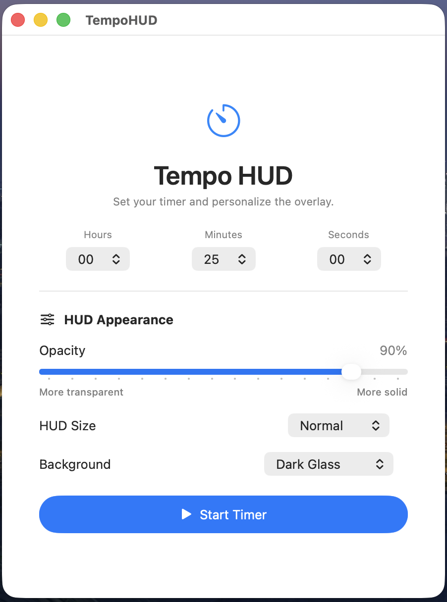
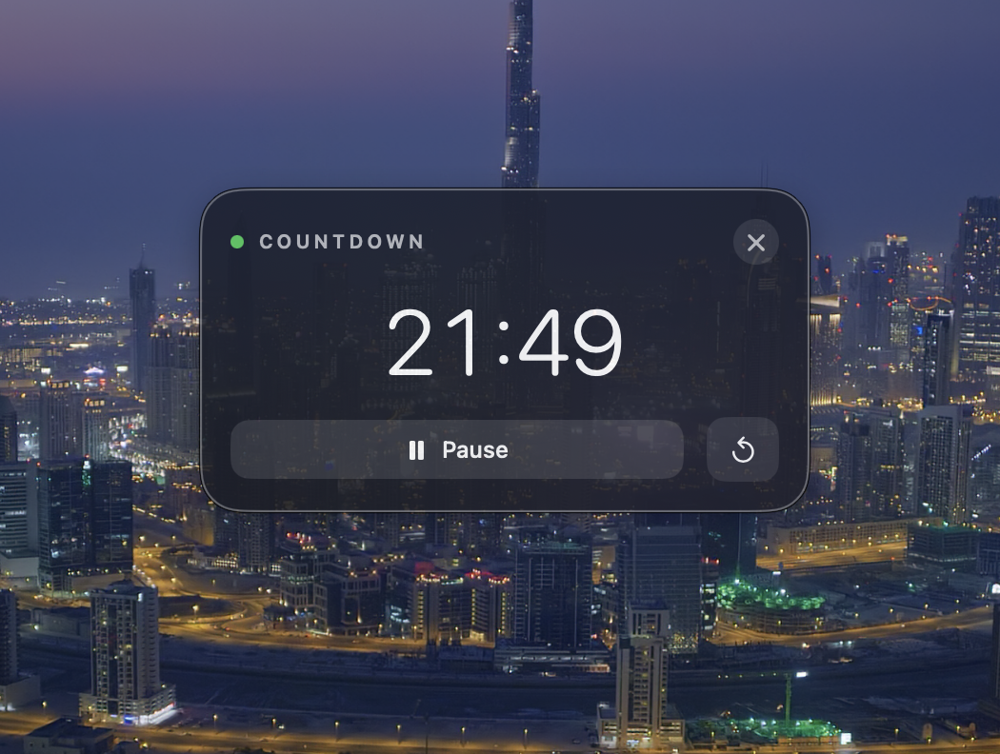
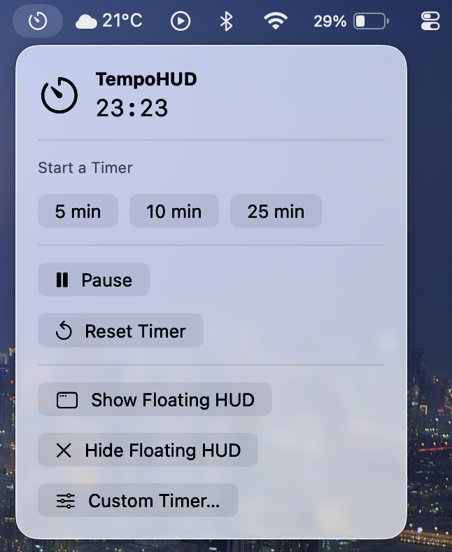

# TempoHUD

**A minimal, transparent, always-on-top countdown timer for macOS.**

TempoHUD is a lightweight native macOS app that keeps a countdown timer visible while you work. Its floating Heads-Up Display (HUD) stays above other windows, so you can keep track of time without switching apps.

Customize the timer's appearance, choose from different sizes and background styles, and control your countdown directly from the macOS menu bar.

## Screenshots

### Setup Window

Configure your countdown, adjust transparency, and customize the HUD before starting your timer.

<p align="center">
  
</p>

### Floating Countdown HUD

Keep your countdown visible above other windows with a clean, floating timer.



### Menu Bar Controls

Access timer controls and presets from the macOS menu bar.

<p align="center">
  
</p>

## Features

- **Always-on-top floating HUD** — Keep your countdown visible while working in other apps.
- **Transparent appearance** — Adjust the HUD's opacity to suit your desktop.
- **Customizable size** — Choose Compact, Normal, or Large.
- **Background styles** — Select from Dark Glass, Frosted Glass, and Light Glass.
- **Custom countdowns** — Set the hours, minutes, and seconds you need.
- **Menu bar integration** — Access timer controls without opening the main setup window.
- **Quick timer presets** — Start common countdowns, including 5, 10, and 25 minutes.
- **Timer controls** — Start, pause, resume, reset, and close the HUD.
- **Completion feedback** — Support for timer-completion alerts and sound options, depending on your app configuration.

## Built With

- **Swift** — Application logic and countdown management.
- **SwiftUI** — Native macOS interface.
- **AppKit** — Floating panel and window management.
- **Xcode** — Development and building.

## Requirements

- A Mac running a compatible version of macOS.
- Xcode with the macOS SDK.
- Swift support matching the version configured in the project.

## Getting Started

### 1. Clone the repository

Open Terminal and run:

```bash
git clone https://github.com/AbhinavGuptaaa/TempoHUD.git
cd TempoHUD
```

### 2. Open the project

Open the Xcode project:

```bash
open TempoHUD.xcodeproj
```

### 3. Build and run

1. Select the **TempoHUD** scheme in Xcode.
2. Choose **My Mac** as the run destination.
3. Press **⌘B** to build the project.
4. Press **⌘R** to run the app.

If Xcode requests signing settings, select your development team or configure signing for local development as appropriate.

## How to Use

1. Launch TempoHUD.
2. Enter your desired hours, minutes, and seconds.
3. Adjust the opacity slider to customize transparency.
4. Choose your preferred HUD size and background style.
5. Click **Start Timer**.
6. Use the floating HUD or the menu bar controls to pause, resume, or reset the countdown.

## Project Structure

```text
TempoHUD/
├── README.md
├── screenshots/
│   ├── setup-window.png
│   ├── floating-hud.png
│   └── menu-bar.png
├── TempoHUD.xcodeproj
└── TempoHUD/
    ├── TempoHUDApp.swift
    ├── ContentView.swift
    ├── TimerModel.swift
    ├── HUDWindowManager.swift
    ├── HUDView.swift
    ├── MenuBarView.swift
    └── CompletionAlertManager.swift
```

*Note: The source-file list above reflects the expected project layout. Update it if your actual filenames differ.*

## Architecture

TempoHUD is built with native macOS frameworks and separates its main responsibilities across dedicated Swift files:

- **`TempoHUDApp.swift`** — App entry point and menu bar integration.
- **`ContentView.swift`** — Setup interface for configuring the countdown and HUD appearance.
- **`TimerModel.swift`** — Countdown state, timing logic, and timer controls.
- **`HUDWindowManager.swift`** — Floating panel creation, window behavior, and appearance settings.
- **`HUDView.swift`** — Visual presentation and controls for the floating countdown.
- **`MenuBarView.swift`** — Menu bar actions and quick timer presets.
- **`CompletionAlertManager.swift`** — Completion notification and sound-related options, where connected.

## Project Goals

TempoHUD aims to make time management easier without adding clutter to your workspace. The goal is a simple, glanceable timer that feels at home on macOS and stays out of the way until you need it.

## Roadmap

Potential future improvements include:

- More timer presets and customization options.
- Additional HUD themes and visual styles.
- Improved accessibility and keyboard shortcuts.
- Further refinements to timer-completion notifications.
- Additional personalization options.

## Contributing

Suggestions, bug reports, and contributions are welcome.

1. Fork the repository.
2. Create a feature branch.
3. Make your changes and test them in Xcode.
4. Submit a pull request with a clear description of your changes.

## License

No license has been specified yet. Unless a license is added to the repository, the code is not automatically available for reuse, redistribution, or modification under an open-source license.

## Author

**Abhinav Gupta**

GitHub: [@AbhinavGuptaaa](https://github.com/AbhinavGuptaaa)

## Support

If you find TempoHUD useful, consider starring the repository on GitHub!

---

*Built with SwiftUI and AppKit for macOS.*
